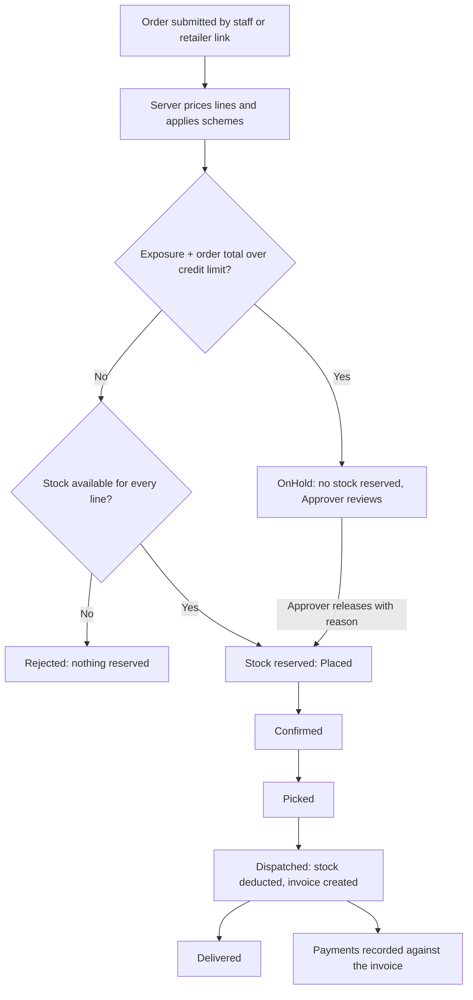

# DistroFlow

Order, stock, credit and payment management for small distributors, built as a multi-tenant SaaS with ASP.NET Core and PostgreSQL.


> **Status:** in development. Planning is complete; implementation follows the module order in [Roadmap](#roadmap). Sections marked *(from Module N)* describe what will work once that module is finished.

---

## Contents

- [The problem](#the-problem)
- [Features](#features)
- [How an order flows](#how-an-order-flows)
- [Design highlights](#design-highlights)
- [Tech stack](#tech-stack)
- [Project structure](#project-structure)
- [Getting started](#getting-started)
- [Configuration](#configuration)
- [Testing](#testing)
- [Documentation](#documentation)
- [Roadmap](#roadmap)
- [Out of scope](#out-of-scope)

---

## The problem

Small distributors take orders by phone and WhatsApp. That leads to wrong prices and schemes, orders accepted for stock that is already gone, retailers exceeding their credit limit, and no record of who did what.

DistroFlow gives the distributor one system that applies each retailer's price list and schemes, checks credit, reserves stock safely, and tracks the order through dispatch, invoicing and payment.

**The customer is the distributor.** Each tenant is one distributor business. Retailers are records the distributor manages; they have no accounts. A retailer can still send an order from a distributor-generated link on a phone.

## Features

| Area | What it does |
|---|---|
| **Access** | Employee sign-in, five roles with fixed permissions, tenant isolation |
| **Products and stock** | Catalog, on-hand / reserved / available stock, full stock movement history |
| **Pricing** | Per-retailer price lists; schemes: Buy N Get M Free and Volume Discount |
| **Retailers** | Retailer records with credit limit, price list, payment terms |
| **Orders** | Server-side pricing, credit check, atomic stock reservation, hold and release, lifecycle, cancellation |
| **Invoicing** | Invoice created at dispatch, numbered per fiscal year, tax-exclusive, PDF |
| **Payments** | Partial payments, outstanding balance, available credit |
| **Reports** | Pending orders, credit holds, outstanding and ageing, low stock, scheme usage |
| **Audit** | Who did what and when, written in the same transaction as the action |
| **Ordering link** | Retailers submit orders from a secure shared link, no login |

### Roles

| Role | Responsibilities |
|---|---|
| Administrator | Employees, products, price lists, schemes, retailers, audit log |
| Sales Staff | Create and confirm orders, cancel orders, retailer profiles, ordering links |
| Dispatch Staff | Stock receipts and adjustments, pick, dispatch, deliver |
| Approver | Release orders held for credit, change credit limits, cancel orders |
| Accounts Staff | Record payments, invoices, outstanding reports |

## How an order flows



An order can be cancelled any time before dispatch; reserved stock is released exactly once.

## Design highlights

These are the parts the project is built to get right.

- **Server decides every number.** Prices, discounts, schemes and totals are calculated on the server; client values are ignored. Price and scheme are snapshotted on each order line, so later price changes never alter existing orders.
- **No over-reservation under concurrency.** Stock is reserved with a single conditional `UPDATE` per line, in a fixed order to avoid deadlocks, inside one transaction. Database constraints back it up (`on_hand >= 0`, `reserved <= on_hand`).
- **No credit-limit bypass.** The retailer row is locked during the credit check, so simultaneous orders from one retailer are evaluated one after the other against current exposure.
- **Safe retries.** Dispatch, cancellation, payments and link submissions are idempotent: no second invoice, no second stock deduction, no second release.
- **Tenant isolation.** The tenant comes from the signed-in employee or the ordering-link record, never from client input. Queries are tenant-scoped, constraints prevent cross-tenant references, and tests prove it.
- **Secure ordering links.** Random 256-bit token, only the hash stored, expiry, revocation, rate limiting, one generic response for invalid links, and the retailer never sees credit, invoices or other retailers.
- **Explainable.** Every order stores its credit decision (limit, exposure, result); every important action is audited with actor and reason.

## Tech stack

| Layer | Technology |
|---|---|
| Backend | ASP.NET Core Web API, C# 14, .NET 10 |
| Data | Entity Framework Core 10, PostgreSQL (GUID/UUID keys) |
| Auth | ASP.NET Core Identity, JWT, role and permission policies |
| Frontend | React + TypeScript (staff app and mobile order page) |
| Testing | xUnit, Testcontainers (real PostgreSQL) |
| Delivery | Docker Compose, GitHub Actions, Serilog, OpenAPI/Swagger |

A modular monolith with Domain, Application, Infrastructure and API layers. Domain has no outward dependencies, and business rules are testable without a database.

## Project structure

```
DistroFlow/
├── .github/workflows/dotnet.yml      CI: build and test
├── src/
│   ├── DistroFlow.Domain/            Entities/ (rules: pricing, credit, state machine)
│   ├── DistroFlow.Application/       DTOs/, Interfaces/, Services/, Validators/
│   ├── DistroFlow.Infrastructure/    Persistence/ (DbContext, configurations, migrations),
│   │                                 Repositories/, Identity/
│   └── DistroFlow.Api/               Controllers/, Program.cs, appsettings
├── tests/
│   ├── DistroFlow.UnitTests/         domain and application rules
│   └── DistroFlow.IntegrationTests/  API and database tests (Testcontainers)
├── frontend/                         React + TypeScript (planned)
├── docs/                             MVP and design documents (planned)
├── compose.yaml                      local PostgreSQL
├── .env.example                      template for .env
├── DistroFlow.slnx
├── .editorconfig
└── README.md
```

## Getting started

*(from Module 1)*

### Prerequisites
- .NET 10 SDK
- Docker Desktop
- Node.js 20 or later
- Git

### Run locally

```bash
git clone https://github.com/navaneeth06/DistroFlow.git
cd DistroFlow

# 1. Configure
cp .env.example .env            # then set POSTGRES_PASSWORD

# 2. Start PostgreSQL (listens on localhost:5433)
docker compose up -d postgres

# 3. Run the API (applies migrations and seeds demo data in Development)
dotnet run --project src/DistroFlow.Api

# 4. Run the frontend
cd frontend
npm install
npm run dev
```

Open `http://localhost:5173`. Swagger is at `http://localhost:<api-port>/swagger` in Development.

### Demo accounts

Seeded in Development only. Passwords come from your `.env`; they are never committed.

| Role | Email |
|---|---|
| Administrator | `admin@demo.local` |
| Sales Staff | `sales@demo.local` |
| Dispatch Staff | `dispatch@demo.local` |
| Approver | `approver@demo.local` |
| Accounts Staff | `accounts@demo.local` |

The demo data matches the scenario used in the end-to-end test: one distributor, a price list, two products with schemes, and a retailer with a 50,000 credit limit.

## Configuration

Configuration is read from environment variables (see `.env.example`).

| Variable | Purpose |
|---|---|
| `ConnectionStrings__Default` | PostgreSQL connection string |
| `Jwt__Issuer`, `Jwt__Audience` | Token issuer and audience |
| `Jwt__SigningKey` | Token signing key (at least 32 random bytes) |
| `Cors__AllowedOrigin` | Frontend origin |
| `Seed__AdminEmail`, `Seed__AdminPassword` | First administrator (created at first start) |

Never commit secrets. Use `dotnet user-secrets` for local development.

## Testing

```bash
dotnet test
```

Integration tests start a real PostgreSQL container with Testcontainers, so Docker must be running. They cover:

- Authentication, permissions and tenant isolation
- Pricing and scheme calculations, including boundary quantities
- Credit decisions and hold/release
- **Concurrent stock reservation** (for example, stock of 20 with ten parallel orders of 5: exactly 4 succeed)
- **Concurrent credit checks** (parallel orders cannot jointly exceed the limit)
- Cancellation, dispatch and payment idempotency
- Ordering-link expiry, revocation and cross-tenant access

## Documentation

| Document | Contents |
|---|---|
| `docs/MVP.md` | Scope, modules, development order, rules, "done when" checks (to be added) |
| `docs/requirements.md` | Detailed requirements with IDs and acceptance criteria (to be added) |
| `docs/technical-design.md` | Data model, API contracts, concurrency design, security (to be added) |

## Roadmap

Built one module at a time; each module ships with its tests and screens.

| # | Module | Status |
|---|---|---|
| 1 | Foundation | ☐ |
| 2 | Identity, Tenant and Access | ☐ |
| 3 | Products and Inventory | ☐ |
| 4 | Price Lists and Schemes | ☐ |
| 5 | Retailers | ☐ |
| 6 | Orders | ☐ |
| 7 | Dispatch and Invoicing | ☐ |
| 8 | Payments | ☐ |
| 9 | Reports and Audit | ☐ |
| 10 | Retailer Ordering Link | ☐ |
| 11 | Release | ☐ |

## Out of scope

Retailer accounts or dashboards, marketplace features, payment gateways, WhatsApp API integration, GST filing and e-invoicing, multiple warehouses, promotion stacking, returns and credit notes, and self-service tenant sign-up and billing.

DistroFlow is a portfolio project. It does not claim production scale, commercial adoption or complete multi-tenant hardening beyond what its tests demonstrate.

## License

To be decided.

## Author

Navaneeth T